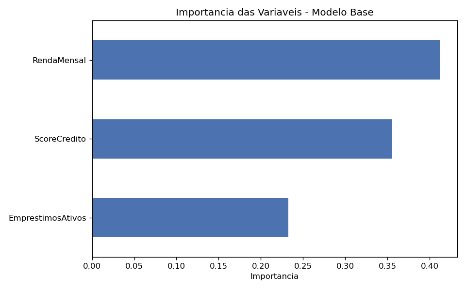
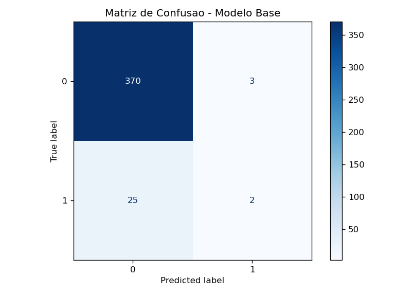
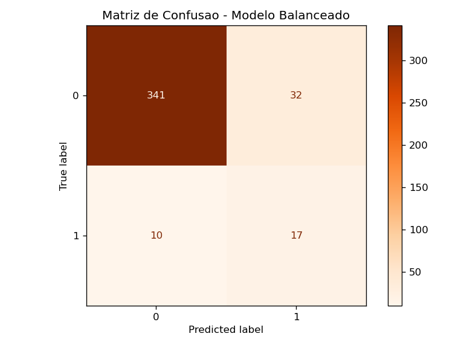
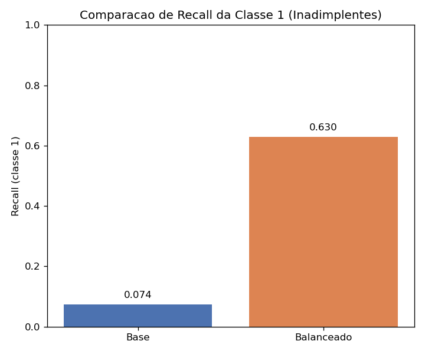

# Modelagem de Risco de Crédito — Avaliação de Inadimplência com Random Forest

Atividade da disciplina **Engenharia de Dados e MLOps**. O projeto treina um
`RandomForestClassifier` para prever inadimplência sobre uma base sintética de
2.000 clientes, analisa a interpretabilidade do modelo, discute criticamente o
desbalanceamento de classes e compara o modelo base com uma versão balanceada.

> Os números apresentados neste README foram gerados pela execução real de
> `main.py` (seed fixa `np.random.seed(42)`), portanto são reproduzíveis. A base
> e a variável alvo seguem exatamente a lógica definida no enunciado da atividade.

---

## 1. Objetivo

Construir e avaliar um modelo de classificação de risco de crédito que estime a
probabilidade de um cliente se tornar **inadimplente** (classe 1) ou **adimplente**
(classe 0), com foco especial na análise de métricas sob desbalanceamento de
classes e no trade-off entre detectar inadimplentes e gerar falsos positivos.

## 2. Descrição dos dados

Base **sintética** com 2.000 clientes, gerada com `np.random.seed(42)` exatamente
conforme o enunciado. Variáveis preditoras (`X`):

```python
np.random.seed(42)
n = 2000
dados = pd.DataFrame({
    "RendaMensal": np.random.exponential(5000, n) + 1500,
    "ScoreCredito": np.random.randint(300, 950, n),
    "EmprestimosAtivos": np.random.poisson(1.5, n),
})
```

| Variável            | Distribuição de geração            | Significado                |
|---------------------|------------------------------------|----------------------------|
| `RendaMensal`       | Exponencial(5000) + 1500           | Renda mensal do cliente (R$) |
| `ScoreCredito`      | Inteiro uniforme em [300, 950)     | Pontuação de crédito       |
| `EmprestimosAtivos` | Poisson(1.5)                       | Nº de empréstimos ativos   |

### Variável alvo `Inadimplente`

Gerada **exatamente** pela regra logística (sigmoide) do enunciado, com
coeficientes fixos e amostragem estocástica contra uma uniforme(0, 1):

```python
prob = 1 / (
    1 + np.exp(
        -(
            -0.0003 * dados["RendaMensal"]
            - 0.005 * dados["ScoreCredito"]
            + 0.8 * dados["EmprestimosAtivos"]
        )
    )
)
dados["Inadimplente"] = (prob > np.random.uniform(0, 1, n)).astype(int)
```

Essa regra produz uma base **fortemente desbalanceada**: **6,8% de inadimplentes**
(135 clientes) contra 93,2% de adimplentes (1.865 clientes). Nenhum coeficiente,
distribuição ou seed foi alterado em relação ao enunciado.

## 3. Metodologia

1. Geração dos dados sintéticos (seed 42).
2. Separação treino/teste estratificada:
   ```python
   X = dados.drop(columns=["Inadimplente"])
   y = dados["Inadimplente"]
   X_tr, X_te, y_tr, y_te = train_test_split(
       X, y, test_size=0.2, random_state=42, stratify=y
   )
   ```
3. Treino do **modelo base** (Random Forest).
4. Avaliação: Acurácia OOB e ROC-AUC no teste.
5. Interpretabilidade: `feature_importances_`.
6. Análise crítica: proporção de inadimplentes, matriz de confusão e
   `classification_report`.
7. Treino do **modelo balanceado** (`class_weight="balanced"`) e nova avaliação.
8. Comparação base × balanceado com foco na classe 1 e no trade-off.

## 4. Parâmetros do Random Forest

Ambos os modelos usam os mesmos hiperparâmetros; o balanceado adiciona
`class_weight="balanced"`.

```python
RandomForestClassifier(
    n_estimators=200,
    max_depth=8,
    max_features="sqrt",
    oob_score=True,
    n_jobs=-1,
    random_state=42,
    # class_weight="balanced"  # apenas no modelo balanceado
)
```

## 5. Métricas utilizadas

- **Acurácia OOB** (`oob_score_`): estimativa out-of-bag no treino.
- **ROC-AUC**: capacidade de ranqueamento, independente de limiar.
- **Precision, Recall, F1-score por classe**: desempenho real por classe,
  essencial sob desbalanceamento.
- **Matriz de Confusão**: contagem de acertos e erros por classe.

## 6. Resultados obtidos

### 6.1 Modelo base

- Acurácia OOB: **0,9344**
- ROC-AUC (teste): **0,8566**
- Acurácia (teste): 0,9300

Matriz de confusão (linhas = real, colunas = previsto):

|            | Prev. 0 | Prev. 1 |
|------------|---------|---------|
| **Real 0** | 370     | 3       |
| **Real 1** | 25      | 2       |

Classification report:

| Classe | Precision | Recall | F1-score | Support |
|--------|-----------|--------|----------|---------|
| 0      | 0,9367    | 0,9920 | 0,9635   | 373     |
| 1      | 0,4000    | 0,0741 | 0,1250   | 27      |

### 6.2 Interpretabilidade — importância das variáveis

| Variável            | Importância |
|---------------------|-------------|
| `RendaMensal`       | 0,4121      |
| `ScoreCredito`      | 0,3555      |
| `EmprestimosAtivos` | 0,2324      |

As três variáveis contribuem de forma relevante, com a `RendaMensal` à frente,
seguida do `ScoreCredito` e dos `EmprestimosAtivos`.



## 7. Análise crítica do desbalanceamento

A base tem apenas **6,8% de inadimplentes** (93,2% são adimplentes). Com essa
proporção, **acurácia elevada pode ser enganosa**: um classificador trivial que
**sempre** prevê "não inadimplente" já atingiria ~93,2% de acurácia, sem detectar
**nenhum** inadimplente (recall da classe 1 = 0). A acurácia é dominada pela
classe majoritária e mascara a incapacidade de identificar o evento de interesse
(a classe 1, que é justamente a que importa no negócio de crédito).

No modelo base isso aparece de forma gritante: embora a acurácia seja 0,9300, o
**recall da classe 1 é apenas 0,0741** — ou seja, de 27 inadimplentes reais no
teste, o modelo detecta somente 2 (25 falsos negativos). Uma acurácia de 93% que
quase não captura inadimplentes é inútil para o negócio. Por isso privilegiamos
precision, recall, f1-score por classe e ROC-AUC em vez da acurácia global.



## 8. Comparação: modelo base × modelo balanceado

| Métrica (classe 1)   | Base     | Balanceado |
|----------------------|----------|------------|
| Precision            | 0,4000   | 0,3469     |
| Recall               | 0,0741   | 0,6296     |
| F1-score             | 0,1250   | 0,4474     |
| ROC-AUC              | 0,8566   | 0,8623     |
| Acurácia (teste)     | 0,9300   | 0,8950     |

Matriz de confusão do modelo balanceado:

|            | Prev. 0 | Prev. 1 |
|------------|---------|---------|
| **Real 0** | 341     | 32      |
| **Real 1** | 10      | 17      |




### Trade-off observado (não basta dizer qual é "melhor")

Com `class_weight="balanced"`, os erros na classe minoritária passam a ser mais
penalizados. O efeito observado nos resultados:

- **Recall da classe 1 dispara** de 0,0741 → 0,6296: o modelo passa a detectar a
  maioria dos inadimplentes (falsos negativos caem de 25 para 10; verdadeiros
  positivos sobem de 2 para 17).
- **Precision da classe 1 cai** de 0,4000 → 0,3469: em troca, surgem mais falsos
  positivos (bons pagadores sinalizados como risco sobem de 3 para 32).
- **F1-score da classe 1 melhora bastante** (0,1250 → 0,4474), porque o enorme
  ganho em recall supera a leve perda de precisão sob este forte desbalanceamento.
- **ROC-AUC** quase não muda (0,8566 → 0,8623): a capacidade de ranqueamento é
  semelhante; o que muda é o ponto de operação (limiar efetivo).

**Conclusão sobre o trade-off:** nenhum modelo é universalmente melhor; a decisão
depende do custo de negócio. Neste cenário, porém, o contraste é marcante:

- O **modelo base**, apesar da acurácia alta (0,9300), é praticamente inútil para
  o objetivo da tarefa: identifica apenas 2 dos 27 inadimplentes (recall 0,074).
  É o exemplo clássico de acurácia enganosa sob desbalanceamento.
- O **modelo balanceado** sacrifica ~3,5 pontos de acurácia global para elevar o
  recall da classe 1 de 0,074 para 0,630 — captura a maioria dos inadimplentes, ao
  custo de mais falsos positivos (precisão da classe 1 cai de 0,40 para 0,35).
- Se **deixar passar um inadimplente** (falso negativo, prejuízo de crédito) for
  mais caro que recusar um bom pagador (falso positivo, custo de oportunidade) — o
  caso típico em risco de crédito — o **modelo balanceado** é claramente mais
  adequado. Se o custo de recusar bons clientes for proibitivo, convém ajustar o
  limiar de decisão em vez de simplesmente escolher um dos dois modelos.

## 9. Como executar

Pré-requisitos: Python 3.x.

```bash
# 1. (opcional) criar e ativar um ambiente virtual
python -m venv .venv
.venv\Scripts\activate      # Windows
# source .venv/bin/activate # Linux/Mac

# 2. instalar dependências
pip install -r requirements.txt

# 3. executar
python main.py
```

Ao rodar, o script imprime um resumo no terminal e gera:

**`evidencias/`**
- `importancia_variaveis.png`
- `matriz_confusao_modelo_base.png`
- `matriz_confusao_modelo_balanceado.png`
- `comparacao_recall.png`

**`resultados/`**
- `base_sintetica.csv` — a base gerada
- `classification_report_base.txt`
- `classification_report_balanceado.txt`
- `resumo_resultados.txt` — todo o log do terminal

## 10. Estrutura do projeto

```
.
├── README.md
├── requirements.txt
├── main.py
├── evidencias/        # gráficos gerados pelo programa
└── resultados/        # CSV e TXT gerados pelo programa
```
